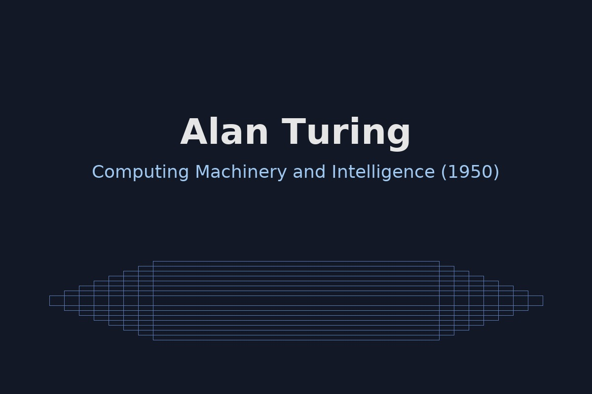

# Alan Turing — піонер комп’ютерних наук і штучного інтелекту <!-- omit in toc -->

## Зміст <!-- omit in toc -->
- [Біографія](#біографія)
- [Ідеї та внесок у AI](#ідеї-та-внесок-у-ai)
- [Основні праці](#основні-праці)
- [Наукова спадщина](#наукова-спадщина)
- [Цікаві факти](#цікаві-факти)
- [Цитата](#цитата)

---

## Біографія

Алан Метінсон Тюрінг народився 23 червня 1912 року в Лондоні, Велика Британія.
Вивчав математику в Кембриджі, згодом працював у Принстоні (США).
Під час Другої світової війни очолював криптоаналітичні роботи в Блечлі‑парку,
де розробив методи та пристрої для розкриття шифру «Енігма».

Після війни Тюрінг зосередився на теорії обчислень, побудові електронних машин
та питаннях **штучного інтелекту**: запропонував ідею машинного мислення і тест,
який сьогодні відомий як **«тест Тюрінга»**.

[↑ До змісту](#зміст)

---

## Ідеї та внесок у AI

Центральні ідеї Тюрінга, що вплинули на **AI** і інформатику:

+ **Машина Тюрінга** — абстрактна модель обчислень, яка формалізує поняття алгоритму.
+ **Тест Тюрінга** — операційний критерій «інтелекту» машини через діалог людини з системою.
+ **Обчислюваність та нерозв’язність** — довів існування задач, які неможливо алгоритмічно розв’язати.
+ **Ранні ідеї навчання** — міркування про *машини, що навчаються* (learning machines), використання випадковості.

[↑ До змісту](#зміст)

---

## Основні праці

- *On Computable Numbers, with an Application to the Entscheidungsproblem* (1936) — закладає основу теорії обчислень.
- Повторні роботи з **криптоаналізу** та архітектури електронних машин (ACE).
- *Computing Machinery and Intelligence* (1950) — стаття, у якій запропоновано **тест Тюрінга**.

<strong>Факти про праці</strong>

- 1936 р.: введення поняття ***універсальної машини***, що може емулювати будь-який алгоритм.
- 1950 р.: формулювання питання «Чи можуть машини думати?» у практичній формі тесту.
- Ідеї Тюрінга випередили появу сучасних мов програмування і комп’ютерів.

[↑ До змісту](#зміст)

---

## Наукова спадщина

- Засновник **теоретичної інформатики** та передумов **AI**.
- Ідеї Тюрінга вплинули на фон Неймана, Чорча, Мінського та ціле покоління дослідників.
- Архітектури комп’ютерів, автоґенерація програм, машинне навчання — усе це спирається на основу,
  яку заклав Тюрінг своїми поняттями алгоритму і обчислюваності.

[↑ До змісту](#зміст)

---

## Цікаві факти

- Посмертно реабілітований та відзначений численними нагородами;
  його портрет зображений на **£50** банкноті Банку Англії.
- Під час війни працював над електромеханічними бомбами для розкриття шифру «Енігма».
- У 1950‑х формулював перші **питання для AI**, які сьогодні обговорюємо в контексті чат‑ботів і AGI.

[↑ До змісту](#зміст)

---

## Цитата

> *«I propose to consider the question, ‘Can machines think?’»* — **Alan Turing**, 1950  
